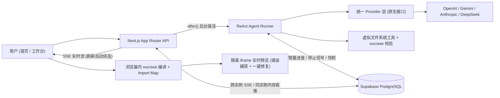

# Atoms Demo 架构与产品说明文档

> 一个由智能体驱动的网页应用生成与实时可视化展示平台：用户输入自然语言需求，系统通过多模型原生接口驱动 ReAct 工具闭环，自动生成多文件 React + TypeScript + Tailwind CSS 应用，并在浏览器隔离沙箱中零延迟渲染与持续迭代。

---

## 1. 实现思路与关键取舍

### 1.1 整体技术架构

### 1.2 核心设计取舍

| 维度 | 最终选型 | 放弃的方案 | 取舍考量 |
| :--- | :--- | :--- | :--- |
| **代码编译与实时预览** | 浏览器内 `sucrase` 极速编译 + ESM `importmap`（`data:` 模块 + `esm.sh`）+ 隔离 `iframe` | WebContainer / Sandpack / 后端 Docker 沙箱 | **毫秒级出图、零冷启动、零沙箱服务器成本**；`iframe` 不开启 `allow-same-origin`，避免生成脚本读取宿主密钥。代价是仅限纯前端应用与浏览器 ESM 兼容生态。 |
| **智能体编排形态** | 单智能体 ReAct 循环（6 个文件工具 + 自动编译校验兜底） | 多角色固定流水线（PM → Designer → Coder → QA） | 单智能体配合局部 `edit_file` 与 `validate_project` 自修闭环，**首字响应快、Token 消耗更低、迭代修改连贯**；缺点是面对超大型多页面系统时，前置需求规划深度不如多阶段拆分。 |
| **多模型接入方式** | 自建轻量 `src/lib/providers/`，各主流厂商优先走**原生 API** | 全部硬塞 OpenAI 兼容层 / 引入重型黑盒框架 | OpenAI（Responses API）、Gemini（原生 `streamGenerateContent` + `thoughtSignature` 透传）、Anthropic（原生 Messages API + `thinking` 签名回传）、DeepSeek（`reasoning_content` 回传）均能完整发挥最新推理与工具调用能力，且代码透明易排查。 |
| **刷新不断流 & Vercel 兼容** | Next.js 15 `after()` 保活 + Supabase 状态同步 + 双通道 SSE（同实例内存直推 / 跨实例轮询） | 纯单机内存队列 / 引入独立 Redis + Worker | **无需额外运维消息队列和常驻 Worker**，同时满足本地开发、刷新自动恢复进度与 Vercel Serverless 多实例部署。代价是受 Serverless `maxDuration`（300s）限制，跨实例模式下存在约 1 秒同步延迟。 |
| **交互与版本边界** | 代码区只读 + 顶栏「纯只读查看历史版本」+ 对话内「无损回滚并同步上下文」 | 在线 Web IDE 手动改代码 / 回滚即截断删除聊天 | 聚焦 AI 对话驱动，不做半成品编辑器；将“对比历史版本”和“真正回滚代码”彻底解耦，防止误覆盖，同时把回滚事实注入后续模型上下文避免幻觉。 |
| **模型密钥策略** | 前端浏览器本地存储 + Next.js API Route 无状态代理 | 服务端托管统一 Key + 账号计费体系 | Demo 阶段开箱即用、零登录门槛，既解决浏览器跨域问题，又确保服务端不落盘用户敏感 API Key。 |

---

## 2. 当前完成程度

### 2.1 已完成能力

- **页面与路由体系**
  - `/` 首页：极简一句话发起构建入口 + 4 个一键填充示例模板。
  - `/projects` 我的项目页：项目搜索、刷新、新建空白项目、删除与进入工作台。
  - `/project/[id]` 分栏工作台：可拖拽调节左右比例，支持深/浅色主题切换。
- **智能体驱动与多模型原生适配（`src/lib/providers/`）**
  - 统一 `ModelProvider` / `ProviderSession` 抽象，内置 **OpenAI（Responses API）**、**Google Gemini（原生 API）**、**Anthropic（原生 Messages API）**、**DeepSeek / OpenRouter / 自定义兼容接口**，支持前端自由切换与连通性测试。
  - 6 个虚拟文件系统工具：`list_files`、`read_file`、`write_file`、`edit_file`、`delete_file`、`validate_project`。
  - 结束前自动编译校验兜底（未校验或编译报错会自动引导智能体自修）。
  - 执行过程可视化：生成中实时展开思考与工具步骤，本轮结束后自动折叠。
- **可视化预览与代码工作区**
  - 支持多文件 React + TypeScript + Tailwind CSS（预置 `lucide-react`、`recharts`、`framer-motion` 等常用库）即时编译与隔离渲染。
  - 桌面 / 平板 / 手机视口切换、刷新、全屏与新标签页打开。
  - 自动捕获预览 `ErrorBoundary`、`window.onerror`、`unhandledrejection` 与 `console.error`，支持一键交由智能体自动修复。
  - 只读语法高亮代码查看器（支持文件树切换与一键复制），支持导出**单页应用 (HTML)** 与 **Vite 源码包 (ZIP)**。
- **持久化、版本与 Serverless 稳定运行**
  - Supabase 数据库完整集成（含标准 CLI 迁移脚本 `supabase/migrations/`），未配置时自动降级本地存储。
  - 仅在代码实际发生内容变化时生成版本快照；支持顶栏无副作用查看历史版本与聊天流内无损回滚。
  - 基于 Next.js `after()` 与 Supabase 状态同步实现刷新不断流、跨实例进度恢复与跨实例中止，已完成 Vercel 部署验证。

### 2.2 尚未实现的能力（当前边界）

- **用户体系与多租户安全隔离**：目前无登录鉴权，`atoms_projects` 为 Demo 演示级开放读写策略，未按 `user_id` 做行级隔离。
- **全栈后端应用生成**：当前生成物为纯前端应用，尚不能为生成的应用自动创建后端 API 或专属数据表。
- **可视化点选精准编辑（Visual Element Picker）**：无法直接在预览画面里点选某个具体 UI 元素并定向修改。
- **公开分享与一键托管发布**：暂未提供独立的公开预览分享链接（`/share/[id]`）或一键部署到外部托管平台。
- **多模态与资产能力**：暂不支持上传 UI 截图/设计稿直接还原代码，也不支持自动生成应用配图。
- **工程可观测性与自动化质检**：未接入 Token/费用统计、生成结果自动视觉巡检（Headless 渲染自测）及后台运行时异常全自动静默修复。

---

## 3. 后续扩展方向与优先级判断

如果继续投入时间，我会按 **「安全可用 → 核心生成体验跃升 → 生态与商业闭环」** 三个梯度推进：

### P0（对外公测前必做 · 决定可用性与传播性）
1. **接入 Supabase Auth 与按用户隔离的 RLS 策略**
   - *理由*：当前所有访问者共享同一张表数据，公网可用前必须完成最小登录态与数据隔离，同时保护后端代理不被滥用。
2. **预览公开分享页（`/share/[id]`）**
   - *理由*：开发成本极低（复用现有 `buildPreviewHtml`），但能立刻让生成的应用拥有可传播的独立体验链接，产品演示价值翻倍。
3. **更强的静态 + 运行时自动自愈**
   - *理由*：当前 `sucrase` 只检查语法和本地导入，不检查 TS 类型错误和未定义变量；补齐轻量类型/引用检查，并将首次渲染的运行时报错改为自动触发一次静默自修，能显著提升「一次生成即完美可玩」的成功率。

### P1（拉开产品差异化 · 决定留存与上限）
1. **预览画面点选元素定向修改（Inspect & Edit）**
   - *理由*：多轮迭代中用户最常遇到的问题是“想微调某个卡片样式但说不清位置”；在 `iframe` 注入轻量选中层并映射回对应组件文件，可将改版精准度提升一个量级。
2. **多模态输入（截图 / 草图 / Figma 还原代码）**
   - *理由*：现有原生 Provider 层（OpenAI / Gemini / Anthropic）均原生支持图片输入，扩展成本可控，且非常贴合真实建站场景。
3. **升级为真实异步队列 + Realtime 推送（替换 1s 轮询）**
   - *理由*：当应用复杂度提高、单次生成超过 3~5 分钟或并发上升时，引入独立队列（如 QStash / Inngest / 独立 Worker）+ Supabase Realtime 能彻底摆脱 Serverless `maxDuration` 限制并降低数据库轮询开销。

### P2（向生产级应用平台演进）
1. **全栈应用生成能力（为生成物提供受限持久化存储 / Edge API）**：让生成的应用从“静态数据前端 Demo”升级为“真正能存业务数据的工具”。
2. **一键发布部署与自定义域名**：对接 Vercel / Cloudflare API，实现从生成到上线的完整闭环。
3. **统一模型网关、Token 计量与配额管理**：面向非技术用户隐藏 API Key 配置门槛，提供开箱即用的平台额度体系与可观测监控。
